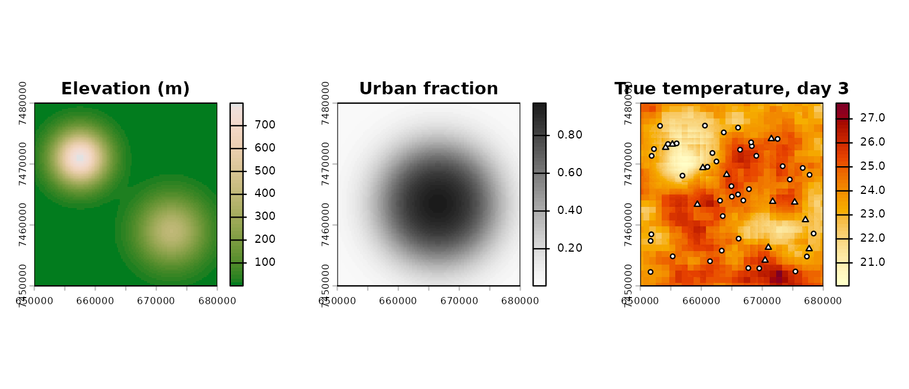

# Get started with bruce

`bruce` turns scattered temperature readings from networks of very
different quality into daily maps for a whole city. This article walks
through the full workflow on a synthetic city, so every step can be
checked against a known truth.

Code that fits models needs R-INLA and is shown but not run when this
page is built; everything else runs.

## A synthetic city

[`bruce_simulate()`](https://asgouveiaa.github.io/bruce/reference/bruce_simulate.md)
invents a 30 km city with two hills, an urban core, 12 reference
stations, 40 low-cost sensors that read 1.5 °C too warm, and a coarse
reanalysis-like background. It returns the “true” temperature on every
pixel, which real data never gives us.

``` r

library(bruce)
sim <- bruce_simulate(n_reference = 12, n_biased = 40, n_days = 5, seed = 1)

head(sim$obs)
#>   station_id       date    value    truth
#> 1      REF01 2025-01-01 27.61612 27.36747
#> 2      REF02 2025-01-01 27.74348 27.75385
#> 3      REF03 2025-01-01 28.51989 28.04309
#> 4      REF04 2025-01-01 27.01882 27.10761
#> 5      REF05 2025-01-01 29.10219 28.70484
#> 6      REF06 2025-01-01 27.62704 27.98792
sim$sources
#>      source  bias obs_sd
#> 1 reference FALSE    0.3
#> 2   lowcost  TRUE     NA
```

``` r

op <- par(mfrow = c(1, 3), mar = c(2, 2, 3, 4))
terra::plot(sim$covariates$elev, main = "Elevation (m)",
            col = hcl.colors(50, "Terrain 2"))
terra::plot(sim$covariates$urb, main = "Urban fraction",
            col = hcl.colors(50, "Grays", rev = TRUE))
terra::plot(sim$truth[[3]], main = "True temperature, day 3",
            col = hcl.colors(50, "YlOrRd", rev = TRUE))
ref <- sim$stations$source == "reference"
points(sim$stations$x, sim$stations$y, pch = ifelse(ref, 24, 21),
       bg = "white", cex = 0.7)
```



``` r

par(op)
```

## 1. Declare the data

Everything city-specific enters through one call. `sources` says which
networks are trusted (`bias = FALSE`) and which get an estimated offset,
and whether each network’s noise is known (`obs_sd`) or estimated
(`NA`).

``` r

d <- bruce_data(sim$obs, sim$stations, sim$sources, crs = sim$crs,
                background = sim$background)
d <- bruce_covariates(d, sim$covariates, background_buffer = 4500)
d
#> <bruce_data>
#>   260 observations, 52 stations, 2025-01-01 to 2025-01-05
#>     source      role obs_sd n_obs
#>    lowcost    biased     NA   200
#>  reference reference    0.3    60
#>   background: 45 cells x days (sd = 0.70)
#>   covariates: elev, urb
```

For a real city the same four objects come from your own databases: one
row per station and day in `obs`, coordinates in `stations`, and a small
table describing each network.

## 2. Mesh and specification

``` r

mesh <- bruce_mesh(d)
spec <- bruce_spec()   # defaults: range prior anchored on station spacing, collapse handling on
```

[`bruce_spec()`](https://asgouveiaa.github.io/bruce/reference/bruce_spec.md)
holds every modelling decision: priors, whether to include the station
and daily terms, and what to do if the spatial field degenerates.

## 3. Fit

``` r

fit <- bruce_fit(d, mesh, spec, keep_config = TRUE)
summary(fit)
bruce_check(fit)   # each fitting attempt and whether the field collapsed
```

When the day-to-day correlation of the field drifts to 1 (a failure seen
with clustered sensor networks),
[`bruce_fit()`](https://asgouveiaa.github.io/bruce/reference/bruce_fit.md)
restarts the optimiser and, if needed, refits with that correlation
fixed. Every attempt is recorded.

## 4. Predict, decompose, aggregate

``` r

pred <- bruce_predict(fit, n_samples = 200, keep_samples = TRUE)
terra::plot(pred$mean[[3]])

dec <- bruce_decompose(fit)
plot(dec, date = "2025-01-03")   # total, covariate part, spatial field

zones <- sf::st_sf(zone = "city", geometry = sf::st_geometry(sim$domain))
bruce_zonal(pred, zones, "zone")
```

[`bruce_decompose()`](https://asgouveiaa.github.io/bruce/reference/bruce_decompose.md)
splits each day’s surface into the part explained by covariates and the
spatial field learned from stations, and reports how much of the spatial
variance each carries, including their covariance.

## 5. Validate

``` r

cv <- bruce_cv(d, mesh, spec, scheme = "lso", checkpoint_dir = "cv_lso")
cv
```

Leave-station-out (`"lso"`) removes one reference station per fold;
leave-region-out (`"lro"`) removes every station in a region, a harder
test of how the map behaves where there is no data. Each fold is saved
as it finishes, so long runs can be resumed.

## Using your own city

The only requirement is the data contract: daily values per station,
station coordinates with a network label, a table describing the
networks, and covariate rasters. An optional gridded product on the same
variable (e.g. ERA5-Land) can be added as background.
`inst/examples/rio_adapter.R` shows the mapping used for Rio de Janeiro.
